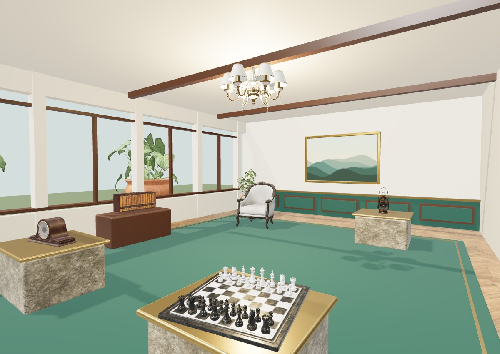

# Memory Palace — Refined V2

A local-first Windows desktop app for turning study material into walkable 3D memory palaces.


## Install

Download **Memory Palace Setup 2.1.0.exe** from this repository's Releases to install, or use **Memory Palace 2.1.0.exe** for the portable edition. Windows 10/11 x64 with hardware-accelerated WebGL2 is required. The build is unsigned; Windows may display an unknown-publisher prompt. Learning and testing work offline. Cloud concept analysis requires internet and your own free OpenRouter API key.

## Study flow

1. Create a palace and upload your own PDFs, TXT, or Markdown files, or paste notes.
2. Choose AI concept analysis, describe your exam goal and review the proposed concepts, practice questions and source evidence. Edit or remove cards before building. Offline passage import is also available.
3. Choose **The Sunlit House** or **The Twilight Carnival**. Your cards are assigned stable locations, with up to 16 memories in each wing.
4. Explore with WASD/arrow keys; drag to look, or capture the mouse. Escape releases the mouse. Press E near an object to read its memory. The route sidebar also supports guided visits.
5. Switch to **Test recall**. Explanations, numbered markers, and guided navigation are hidden. A shuffled practice question or concept title prompts you to walk to its original location and place it with E. Skip if you cannot recall it.
6. Review your score and mistaken locations, return to Learn mode, and revise. Completed attempts and explored cards are saved automatically.

Export a `.palace.json` backup from a palace's menu. Restore creates a separate copy, preserving the original. Data lives in IndexedDB within the desktop app profile; uninstalling or clearing that profile can remove it.

## What ships

- Two navigable environments, 26 locally bundled textured glTF props, PBR surface maps, lighting, shadows, and a configurable rendering resolution.
- PDF/text import with free cloud concept analysis or explicit offline passage import.
- Editable cards, source references, up to 160 cards across 10 wings.
- Spatial placement tests, score history, local persistence, export/restore, rename/delete.
- Electron desktop shell with sandboxing, context isolation, disabled Node integration, restricted navigation, and a local application protocol.
- Windows installer and portable packaging; core tests, browser integration tests, and packaged-app smoke test.

## Current boundaries

This release adds source-grounded cloud AI and detailed procedural room layouts. See [Free AI setup](docs/AI-SETUP.md) for key instructions, free-model availability and quotas, and [v2.1 changes](docs/V2.1-CHANGES.md) for environment details and verification boundaries.

AI proposes study concepts and practice questions; it cannot predict an examiner's questions or guarantee correctness. Source quotes are verified but explanations still need review. Scanned images, diagrams and complex tables need OCR/transcription. The free API requires the user's own key; authenticated model quality was not evaluated without one. Manual passage import remains an explicitly selected offline alternative.

New palaces use four detailed zones with seeded placements; old palaces retain their learned locations. There are still two custom environments, not a large photorealistic environment marketplace. The desktop renderer remains Three.js/Electron. There is no cloud sync, code signing or automatic updater yet.
## Develop

Use Node.js 24 LTS with npm and Git.

```sh
npm ci
npm run dev
npm run build
npm run desktop
```

All required models, textures, fonts, and PDF support files are committed under `public/`. `npm run assets` re-downloads the curated Poly Haven assets. `node scripts/prepare.mjs` refreshes PDF support files and fonts if dependencies change. These maintenance scripts require internet access; using the app does not.

```sh
npm test
npx playwright install chromium
npm run test:e2e
npm run package
node scripts/electron-smoke.mjs
```

`npm run package` builds the installer and portable executable in `release/`. Windows packaging should run on Windows. `scripts/electron-smoke.mjs` tests the unpacked executable using an isolated temporary user profile.

## Structure

| Path                         | Purpose                                            |
| ---------------------------- | -------------------------------------------------- |
| `src/core.ts`                | Cards, extraction, scoring, import validation      |
| `src/import.ts`              | Local PDF.js and text-file ingestion               |
| `src/storage.ts`             | IndexedDB persistence                              |
| `src/main.ts`                | Library, creation, review, learning and testing UI |
| `src/scene.ts`               | Environments, glTF props, navigation and rendering |
| `public/assets/catalog.json` | Asset provenance and licenses                      |
| `electron/main.cjs`          | Sandboxed desktop entry point                      |
| `tests/`                     | Core, PDF and full workflow checks                 |

## Assets and attribution

Powered by [Poly Haven](https://polyhaven.com). Their bundled models and textures are [CC0](https://polyhaven.com/license). See `public/assets/catalog.json` and `THIRD_PARTY_NOTICES.md`. Environment geometry is authored for this project. Source previews are rendered from the actual bundled scenes.
